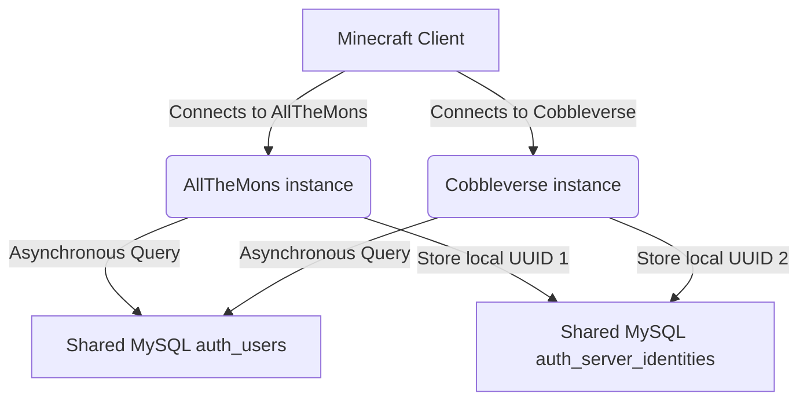

# Architecture: Global Authentication System

This document outlines the design and architecture of the shared global authentication system in EasyLogin for the BigBangCraft servers (`allthemons` and `cobbleverse`).

## Overview

The Global Authentication System decouples the player's credentials from their local server identity (such as their local UUID). It introduces:

1. **Global Account**: Identified by a unique, normalized nickname. The password and registration are global across all network servers.
2. **Local Identity**: Tracks the player's UUID and active sessions on each server. A player can have different UUIDs on `allthemons` and `cobbleverse` while sharing the same credentials.
3. **Local Session**: Authad sessions are local to each server instance. When a player logs in to `allthemons`, they are not automatically logged in to `cobbleverse` (SSO/session sharing is explicitly disabled).

## Relational Database Schema

### 1. `auth_users`
Stores global account credentials.

| Field | Type | Description |
|---|---|---|
| `id` | BIGINT | Auto-increment primary key |
| `public_id` | VARCHAR(36) | Stable public identifier |
| `username_display` | VARCHAR(64) | Original nickname capitalization |
| `username_normalized` | VARCHAR(64) | Lowercase, normalized unique key |
| `password_digest` | VARCHAR(255) | BCrypt hash of the global password |
| `status` | VARCHAR(32) | Account status (`active`, `blocked`) |
| `created_at` | TIMESTAMP | Creation time |
| `updated_at` | TIMESTAMP | Last update time |
| `password_changed_at` | TIMESTAMP | Last password change |
| `last_global_login_at` | TIMESTAMP | Last global authentication time |

### 2. `auth_server_identities`
Maps global accounts to local servers and UUIDs.

* **Constraint**: Unique on `(auth_user_id, server_id)`.

| Field | Type | Description |
|---|---|---|
| `id` | BIGINT | Auto-increment primary key |
| `auth_user_id` | BIGINT | Foreign key references `auth_users(id)` |
| `server_id` | VARCHAR(64) | Server instance ID |
| `current_uuid` | VARCHAR(36) | Active UUID on this server |
| `first_seen_at` | TIMESTAMP | First join time |
| `last_seen_at` | TIMESTAMP | Last join time |
| `last_authenticated_at` | TIMESTAMP | Last successful login/register time |

### 3. `auth_server_uuid_history`
Maintains an audit trail of UUID mappings.

* **Constraint**: Unique on `(server_id, minecraft_uuid)`. Ensures that a UUID cannot be claimed by two different accounts on the same server.

| Field | Type | Description |
|---|---|---|
| `id` | BIGINT | Auto-increment primary key |
| `auth_server_identity_id` | BIGINT | References `auth_server_identities(id)` |
| `server_id` | VARCHAR(64) | Server instance ID |
| `minecraft_uuid` | VARCHAR(36) | Minecraft player UUID |
| `first_seen_at` | TIMESTAMP | Observation start time |
| `last_seen_at` | TIMESTAMP | Observation end time |
| `source` | VARCHAR(64) | Context of mapping creation |

---

## Normalization & Casing Rules

To prevent registration spoofing or duplicate accounts, nickname normalization is handled by the `UsernameNormalizer` class using the following steps:
1. **Trim**: Remove leading/trailing whitespaces.
2. **Unicode NFC**: Normalize characters to NFC form.
3. **Lowercase**: Convert nickname to lowercase using `Locale.ROOT`.

Two nicknames that normalize to the same string are treated as the same global account.
The display capitalization is saved exactly as supplied during the first registration in `username_display`.
