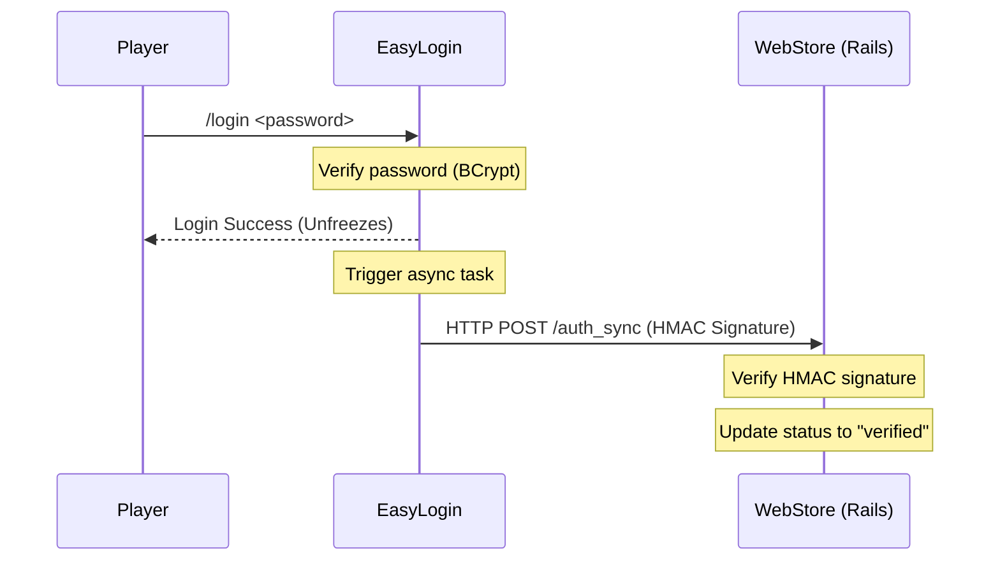

# Integration: WebStore Identity Synchronization

This document explains the automatic, asynchronous identity synchronization flow between EasyLogin and the Rails WebStore. This mechanism makes commands like `/vincular` obsolete.

## How it works

1. **Observed Status**: EasyVip continues to notify the Rails store of player presence when players join the server.
2. **Verified Status**: EasyLogin asynchronously triggers a secure WebStore Identity Sync request **only** after a successful `/register` or `/login` action.
3. **Security Headers**: The synchronization request includes a timestamp, a secure nonce, and an HMAC-SHA256 signature calculated using the shared secret token to prevent payload tampering.



## Configuration

Enable and configure the sync client under the `[webstore]` block in `config.toml`:

```toml
[webstore]
enabled = true
url = "https://store.bigbangcraft.com.br/api/v1/auth_sync"
token = "webstore_secret_token"
```

## Security & Verification

The sync request sends the following headers:
- `X-EasyLogin-Timestamp`: Epoch millisecond timestamp.
- `X-EasyLogin-Nonce`: Random verification nonce.
- `X-EasyLogin-Signature`: Hex-encoded HMAC-SHA256 signature of `Timestamp + Nonce + Body`.

The request body JSON payload format:

```json
{
  "event_id": "893cfa32-3481-4228-a329-87a27bf7de93",
  "global_account_id": "f81d4fae-7dec-11d0-a765-00a0c91e6bf6",
  "username": "PedropsRei",
  "canonical_username": "pedropsrei",
  "server_id": "allthemons",
  "minecraft_uuid": "11111111-1111-1111-1111-111111111111",
  "verified_at": 1783478239000
}
```

* **No Credentials**: EasyLogin never transmits the password or password digest to external stores.
* **Retry Protocol**: Requests are executed on a dedicated background thread. If the WebStore is down or slow, failed requests are queued and retried asynchronously without blocking the player's login or register flows.
